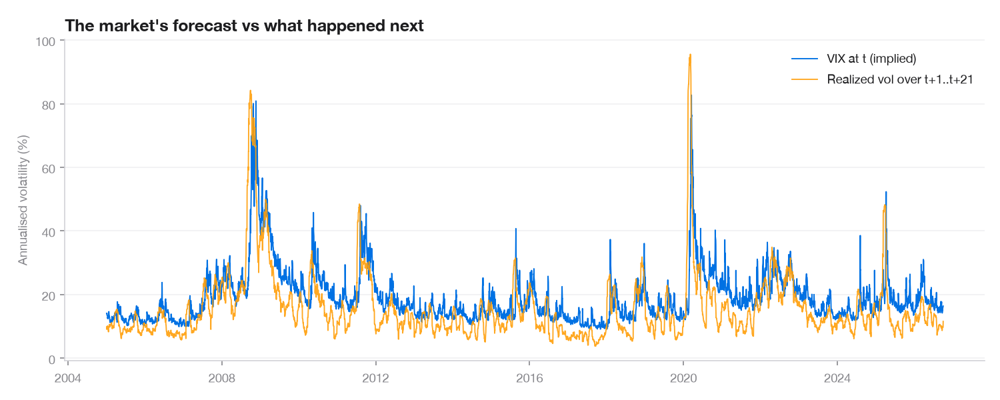
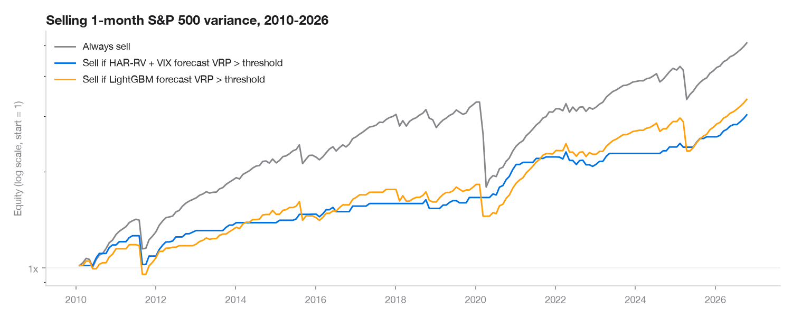

# Volatility Risk Premium on the S&P 500

> **From 2005 to 2026, the VIX overstated the S&P 500's next-month realized volatility by 3.5 vol points on average (median 4.3), on 84% of days.** A HAR-RV model using the VIX cuts the forecasting error by 14% versus a naive model. Selling 1-month variance only when the forecast premium exceeds 2 points cuts the maximum drawdown from −46% to −19%, but most of its Sharpe edge depends on the roll date.

**Website:** https://donyvano.github.io/estimateur_prime_volatilite/ · **Methodology:** [docs/methodology.md](docs/methodology.md)



---

## Key results

| Step | Result |
|---|---|
| **Premium** (2005–2026, 5,471 days) | mean VIX 19.1% vs realized 15.6% → **+3.5 vol points**; worst −72 points on 20 Feb 2020 |
| **Smile** (SPY, 30 Oct 2026) | ATM 1-month 15.8%, 90% put 27.1%, 110% call 12.4% → **14.7-point skew**; VIX at 19.4% |
| **Forecasting** (walk-forward 2010–2026) | RMSE vs naive: HAR-RV + VIX **−13.8%**, LightGBM −11.2%, HAR-RV −9.5%, GARCH −7.4% |
| **Backtest** (201 months) | always sell: Sharpe 0.76, max DD −46%, skew −4.5 · conditional HAR + VIX: Sharpe 0.92, max DD −19% |
| **Robustness** | over the 21 possible roll dates, the conditional strategy's Sharpe ranges from 0.36 to 1.71 |



## What is in the box

```
   S&P 500, VIX, T-bills ──► Realized vol (close-to-close, Parkinson)
           (yfinance)                │
                                     ▼
   SPY option chain ──► Black-Scholes + greeks ──► Implied vol (Newton + Brent) ──► smile / surface
                         Monte Carlo (1/√N)
                                     │
                                     ▼
                VRP(t) = VIX(t) − realized vol over t+1..t+21     ◄── explicit look-ahead tests
                          │                          │
                          ▼                          ▼
        Forecasts: naive, HAR-RV, GARCH,     Backtest: short 1-month variance swap,
        HAR + VIX, LightGBM (walk-forward)   always vs conditional, tail & roll-date analysis
                          │                          │
                          └────────► export.py → web/data/*.json → static website (GitHub Pages)
```

## Quickstart

```bash
python3.11 -m venv .venv && source .venv/bin/activate
pip install -r requirements.txt          # installs the vrp package in editable mode
python -m vrp.pipeline                   # download (cached) → compute → web/data/*.json
pytest                                   # 115 tests, offline
python -m http.server 8000 -d web        # open http://localhost:8000
```

Options: `--refresh` re-downloads prices; `--refresh-options` takes a new option chain snapshot (run during US market hours to get bid/ask quotes). On macOS, LightGBM needs OpenMP: `brew install libomp`.

## Project structure

```
config/config.yaml   every parameter: tickers, windows, filters, model and backtest settings
src/vrp/
  data.py            download, parquet cache, cleaning and sanity checks
  realized_vol.py    close-to-close and Parkinson estimators
  black_scholes.py   prices and greeks (vectorized)
  monte_carlo.py     GBM pricer, convergence study, antithetic variates
  implied_vol.py     Newton/Brent inversion, implied forward, filters, surface
  premium.py         look-ahead-free alignment, VRP statistics, crisis table
  forecast.py        features, walk-forward with purge, HAR / GARCH / LightGBM, QLIKE
  backtest.py        variance swap P&L, strategies, performance, tail and roll-date analysis
  export.py          JSON export for the website
  pipeline.py        end-to-end run
tests/               pytest suite (look-ahead tests in test_premium.py and test_forecast.py)
web/                 static site (HTML/CSS/JS + Plotly), reads web/data/*.json
docs/                methodology, interview pitch, self-quiz, figures
```

## Engineering choices

- **No look-ahead:** every feature at date *t* is known at the close of *t*. Tests shock the future and check that nothing changes up to *t*. Walk-forward validation uses a 21-day purge.
- **No data snooping in the backtest:** the threshold is fixed a priori, both model signals are reported, and the sensitivity to threshold and roll date is shown rather than optimized.
- **Reproducible:** central config, fixed seeds, parquet cache, `logging` everywhere, CI (ruff + pytest) on every push.

## Limitations

- `yfinance` has no historical option chains: the historical premium relies on the VIX, and the surface on a single dated snapshot (taken after the close, from last traded prices).
- The variance swap is a proxy: the VIX is not tradable and real swap strikes sit slightly above it.
- SPY options are American. They are priced as European, which is acceptable for the OTM options kept here.

Next steps: per-strike premium with historical option data, intraday realized volatility, Diebold-Mariano tests, volatility-targeted sizing.

## License

MIT © Yvan Nedelec
